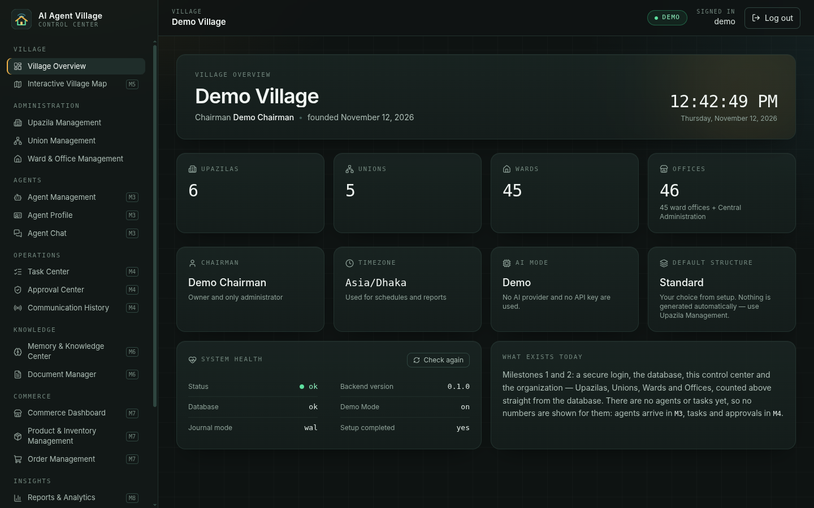
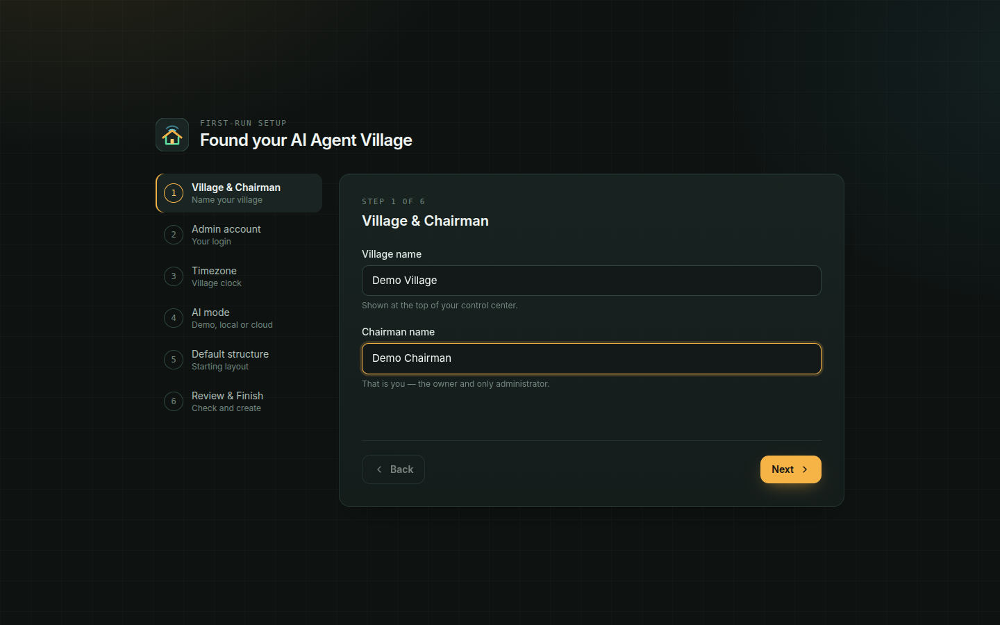
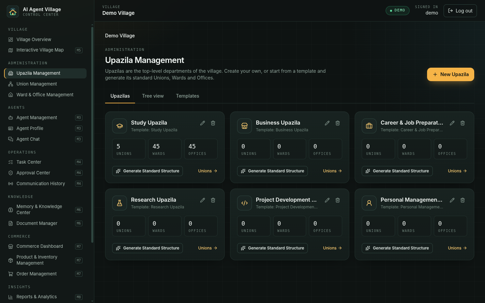
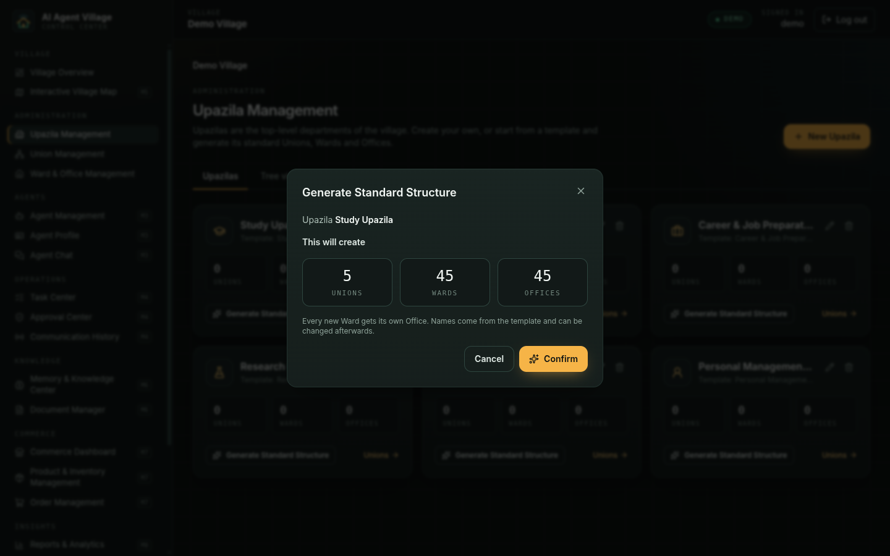
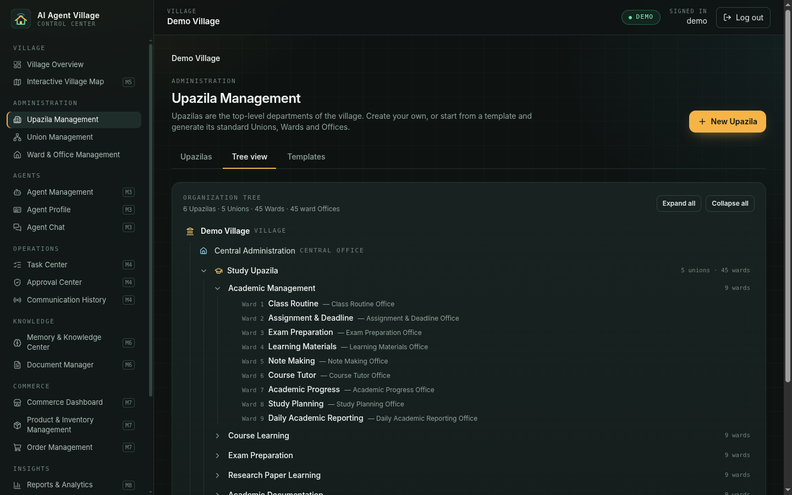
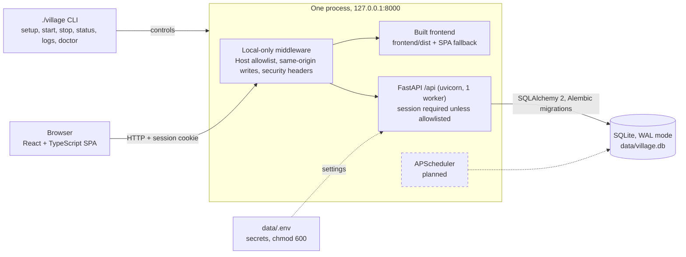

# AI Agent Village

**A local-first control center for a personal team of AI agents, organized like a Bangladeshi village.**




## What is it?

AI Agent Village is a personal, single-user platform for managing AI agents from one web
dashboard, running entirely on your own PC. Its structure is modelled on a Bangladeshi
administrative village: **Village → Central Administration → Upazila → Union → Ward → Office →
Agents**. Today the foundation and the whole organization layer work; the agents themselves come
next (see [Status](#status)).

## Status

Built one milestone at a time. Each milestone is tested before the next one starts.

| Milestone | Scope | Status |
| --- | --- | --- |
| **M1** | Foundation: `./village` CLI, backend core, login, first-run wizard, app shell | ✅ Done, accepted |
| **M2** | Organization: Upazila / Union / Ward / Office, templates, standard structure, tree view | ✅ Done, tested (owner sign-off on the live install pending) |
| **M3** | Agents and AI model settings | ⏳ Planned |
| **M4** | Tasks, approvals, agent communication | ⏳ Planned |
| **M5** | Interactive village map | ⏳ Planned |
| **M6** | Memory, knowledge and documents | ⏳ Planned |
| **M7** | Commerce and integrations | ⏳ Planned |
| **M8** | Reports, settings, backup and restore, system health | ⏳ Planned |
| **M9** | Background automation and release hardening | ⏳ Planned |

✅ done · 🚧 in progress · ⏳ planned. Nothing is in progress right now. The split of M3–M9 is
provisional and may change. [`PROGRESS.md`](PROGRESS.md) is the detailed, honest log, including
known issues.

## Features (working today)

**Foundation (M1)**

- **One command to run it**: `./village setup` then `./village start`. No Docker, no database server.
- **First-run wizard** in the browser (6 steps) that creates the village and the admin account in
  one database transaction.
- **Login** with argon2id password hashing, server-side sessions and a login lockout.
- **Control-center UI**: dark dashboard with all 22 pages of the spec in the sidebar. The 18 pages
  that are not built yet say "Coming in M‹n›" and show no data.
- **No fake numbers**: everything on screen comes from the backend.

**Organization (M2)**

- **Upazila, Union, Ward and Office management**: create, rename and delete at every level.
  Deleting needs the exact name typed and cascades down the hierarchy.
- **Six Upazila templates** (Study, Business, Career, Research, Project Development, Personal
  Management), editable in the UI without touching code.
- **Generate Standard Structure**: preview the counts, confirm, done. For the Study template that
  is 5 Unions, 45 Wards and 45 Offices, created in one transaction. Running it again creates nothing.
- **Tree view and breadcrumbs**: a collapsible tree of the whole organization, built from plain
  buttons and links as the accessible alternative to the future map.
- **Live counts** of Upazilas, Unions, Wards and Offices on the overview.

> **Not there yet:** there are no agents, tasks or AI calls. The wizard stores your AI mode
> (Demo, Ollama or Anthropic), but no AI provider has been implemented or contacted so far.

## Screenshots

Real screenshots of the running app on a throwaway demo database.

<table>
  <tr>
    <td width="50%"><br><sub>First-run setup wizard</sub></td>
    <td width="50%"><br><sub>Upazila Management</sub></td>
  </tr>
  <tr>
    <td width="50%"><br><sub>Generate Standard Structure: preview before anything is written</sub></td>
    <td width="50%"><br><sub>Organization tree view</sub></td>
  </tr>
</table>

## Architecture



Key design decisions:

- **Local-first.** The server binds to `127.0.0.1` only, and the configuration rejects any
  non-loopback host. Your data stays in one SQLite file on your disk.
- **One process.** A single uvicorn worker serves the API and the built frontend. Nothing else to
  install, start or keep alive.
- **Alembic from day one.** Every schema change is a hand-written migration; `create_all()` is
  never used. The M2 migration was verified on a copy of a real M1 database before release.
- **Default-deny API.** Every `/api` route needs a session unless it is on a four-entry public
  allowlist. A test enumerates all routes, so a new unprotected route fails the build.
- **Secrets only in `data/.env`.** API keys never go into the database, the logs or an API response.
- **Works with no API key.** The app is fully usable without any AI credentials; the planned Demo
  provider keeps it that way once agents arrive.

## Tech stack

| Layer | Technology |
| --- | --- |
| Backend | Python 3.12+, FastAPI, Pydantic v2, SQLAlchemy 2 (typed), Alembic, uvicorn |
| Database | SQLite in WAL mode with foreign keys on |
| Auth | argon2id (`argon2-cffi`), server-side sessions |
| Frontend | React 19, TypeScript, Vite, Tailwind CSS 4, React Router, Lucide icons |
| Tests | pytest, Vitest + React Testing Library |
| Tooling | Bash CLI (`./village`), GitHub Actions |

## Quick start

For Ubuntu. Prerequisites:

- **Python 3.12+** with venv: `sudo apt install python3 python3-venv`
- **Node.js 20.19+** with npm (Node 22 LTS recommended; running the frontend tests needs 22.12+)

```bash
git clone https://github.com/abs-rio09/ai-agent-village.git
cd ai-agent-village
./village setup
./village start
```

Open <http://127.0.0.1:8000> and follow the setup wizard. `./village` never uses `sudo`; if
something is missing, `./village doctor` says what and prints the exact command to install it.

| Command | What it does |
| --- | --- |
| `./village setup` | Creates the venv, installs dependencies, creates `data/.env` once, migrates the database, builds the frontend. Safe to re-run. |
| `./village start` | Starts the server in the background and waits until it is healthy. |
| `./village stop` | Stops it (SIGTERM, then SIGKILL after 10 s). |
| `./village restart` | Stop, then start. |
| `./village status` | Running or stopped, PID, uptime, health. |
| `./village logs` | Last 100 log lines; `logs -f` follows. |
| `./village doctor` | PASS / WARN / FAIL environment checks. |
| `./village backup` | ⏳ Planned (M8) |
| `./village restore` | ⏳ Planned (M8) |

Port already taken? `VILLAGE_PORT=8010 ./village start`.

## Security & privacy

- **Localhost only**: binds to `127.0.0.1`; a Host-header allowlist blocks DNS rebinding, and
  state-changing requests must come from the same origin.
- **Passwords** are hashed with argon2id. Validation errors never echo the rejected input.
- **Sessions**: `HttpOnly`, `SameSite=Strict` cookie; only the SHA-256 of the token is stored.
- **Login lockout**: 5 failed attempts per username lock it for 5 minutes (kept in memory, so it
  resets when the server restarts).
- **Keys stay out of the database and logs**: an API key is written only to `data/.env`
  (mode 600) and is never returned by the API.
- **No agent shell access, by design**: agents (M3+) will work through a registry of explicit
  tools with approvals, never arbitrary shell or filesystem access.

This is a single-user tool for your own machine. It is served over plain HTTP on localhost and is
not meant to be exposed to a network.

## Testing

```bash
cd backend && ../.venv/bin/pytest    # backend
cd frontend && npm test              # frontend (Vitest, runs once)
cd frontend && npm run build         # type-check + production build
```

Current results (M2): **pytest 121 passed, 1 skipped** (the skipped test needs `shellcheck`;
with it installed, 122 pass) and **Vitest 51 passed**. Tests never touch the real database or
`data/.env`. The GitHub Actions workflow in [`ci.yml`](.github/workflows/ci.yml) runs both suites
and the build on every push and pull request.

## Project structure

```text
ai-agent-village/
├── village              # Bash CLI: setup, start, stop, restart, status, logs, doctor
├── backend/
│   ├── app/             # FastAPI app: main, config, db, models, security, api/ routers
│   ├── alembic/         # hand-written migrations (0001–0003)
│   └── tests/           # pytest; every test gets a temp DB and a temp .env
├── frontend/
│   └── src/             # React app: pages/, components/, typed API client, tests
├── docs/
│   ├── SPEC.md          # feature specification
│   └── screenshots/
├── data/                # village.db and .env (git-ignored)
├── logs/  run/          # log file and PID file (git-ignored)
├── CLAUDE.md            # project rules for the AI coding assistant
└── PROGRESS.md          # honest status log, updated every session
```

## Roadmap

All of this is **planned, not built**. The order and grouping may change.

- **M3**: agents created from templates and assigned to offices; AI providers (Demo, Ollama, Anthropic).
- **M4**: tasks routed through a Central Manager, approval requests, agent-to-agent messages.
- **M5**: interactive village map with agent characters; the tree view stays as the accessible alternative.
- **M6**: village, Upazila and agent memory; local document upload and search.
- **M7**: products, inventory and orders; Messenger integration in a sandbox mode.
- **M8**: reports, application settings, backup and restore, system health and logs.
- **M9**: background scheduler (APScheduler), persistent task queue, recovery after restart, release hardening.

## How it was built

I designed and directed this project; the code was implemented with
[Claude Code](https://claude.com/claude-code). I wrote the specification
([`docs/SPEC.md`](docs/SPEC.md)), fixed the technical decisions ([`CLAUDE.md`](CLAUDE.md)), wrote
a prompt for each milestone, and reviewed and tested the result after each one before moving on.
[`PROGRESS.md`](PROGRESS.md) records what was actually run and tested, and what was not.

## Author

**Abu Bakkar Siddik (Rio)**, CSE student, Green University of Bangladesh.
GitHub: [@abs-rio09](https://github.com/abs-rio09)

## License

[MIT](LICENSE) © 2026 Abu Bakkar Siddik
