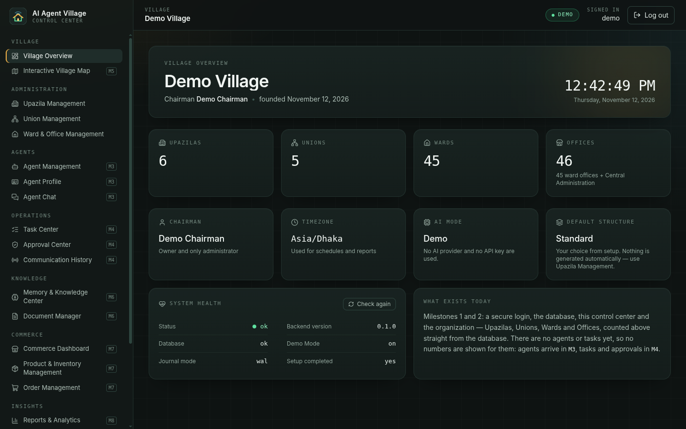
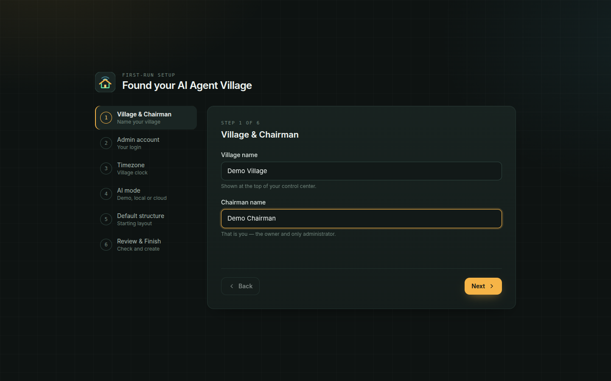
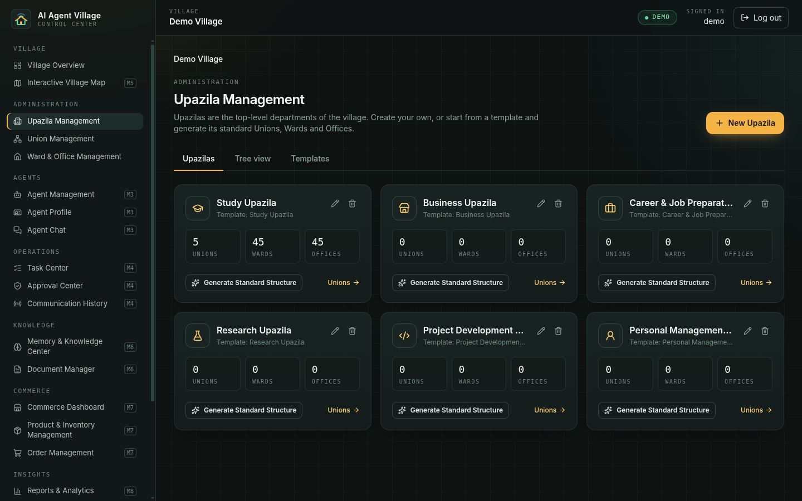
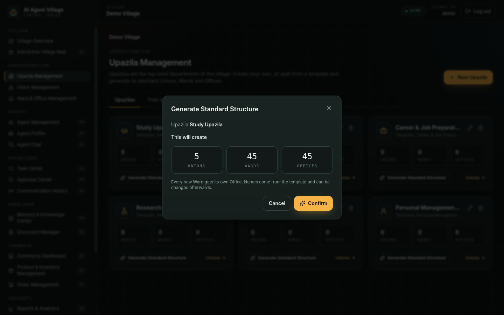
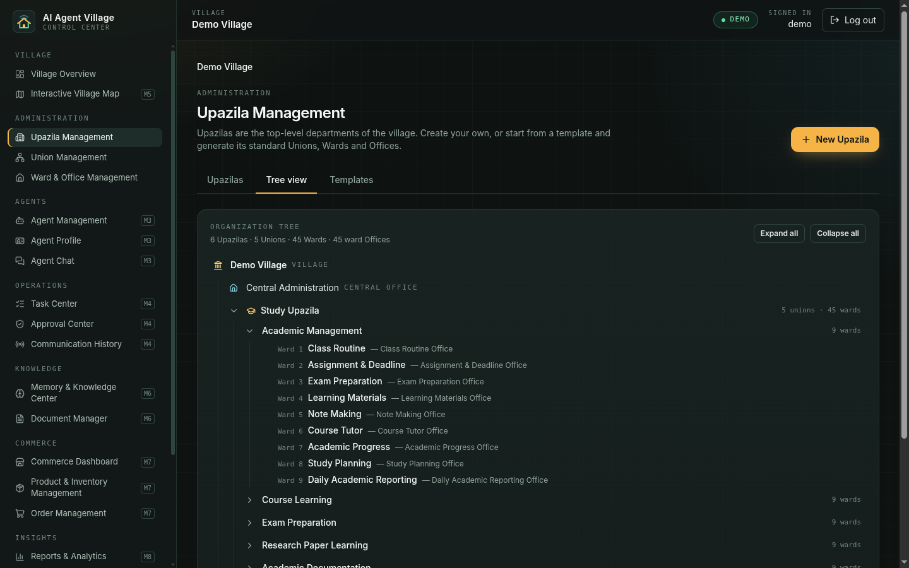
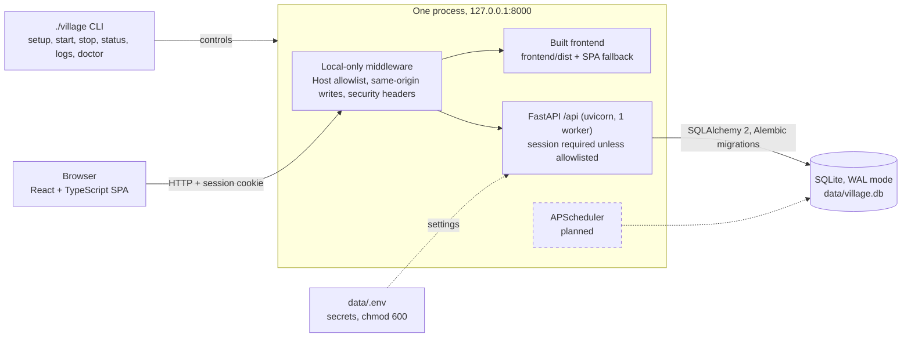

# AI Agent Village

**A local-first control center for a personal team of AI agents, organized like a Bangladeshi village.**




## What is it?

AI Agent Village is a personal, single-user platform for managing AI agents from one web
dashboard, running entirely on your own PC. Its structure is modelled on a Bangladeshi
administrative village: **Village → Central Administration → Upazila → Union → Ward → Office →
Agents**. Today the foundation, the organization layer and the first agent layer work: agents are
created from templates and a Central Manager routes requests to them. Replies still come from a
rule-based Demo provider, not from an AI model (see [Status](#status)).

## Status

Built one milestone at a time. Each milestone is tested before the next one starts.

| Milestone | Scope | Status |
| --- | --- | --- |
| **M1** | Foundation: `./village` CLI, backend core, login, first-run wizard, app shell | ✅ Done, accepted |
| **M2** | Organization: Upazila / Union / Ward / Office, templates, standard structure, tree view | ✅ Done, tested (owner sign-off on the live install pending) |
| **M3** | Agents and tasks: agent registry and templates, Demo provider, Central Manager routing, task queue, delegation | ✅ Built, tested (owner sign-off on the live install pending) |
| **M4** | Control: tool registry, enforced permissions, approvals, audit log, memory scopes, scheduler | ✅ Built, tested (owner sign-off on the live install pending) |
| **M5** | Interactive village map | ⏳ Planned |
| **M6** | Knowledge and documents (the three memory scopes were built in M4) | ⏳ Planned |
| **M7** | Commerce and integrations | ⏳ Planned |
| **M8** | Reports, settings, backup and restore, system health | ⏳ Planned |
| **M9** | Real AI providers and their settings, agent chat, communication history, release hardening | ⏳ Planned |

✅ done · 🚧 in progress · ⏳ planned. Nothing is in progress right now. The split of M5–M9 is
provisional and may change. [`PROGRESS.md`](PROGRESS.md) is the detailed, honest log, including
known issues.

## Features (working today)

**Foundation (M1)**

- **One command to run it**: `./village setup` then `./village start`. No Docker, no database server.
- **First-run wizard** in the browser (6 steps) that creates the village and the admin account in
  one database transaction.
- **Login** with argon2id password hashing, server-side sessions and a login lockout.
- **Control-center UI**: dark dashboard with all 22 pages of the spec in the sidebar. The 14 pages
  that are not built yet say "Coming in M‹n›" and show no data.
- **No fake numbers**: everything on screen comes from the backend.

**Organization (M2)**

- **Upazila, Union, Ward and Office management**: create, rename and delete at every level.
  Deleting needs the exact name typed and cascades down the hierarchy.
- **Six Upazila templates** (Study, Business, Career, Research, Project Development, Personal
  Management), editable in the UI without touching code.
- **Generate Standard Structure**: preview the counts, confirm, done. For the Study template that
  is 5 Unions, 45 Wards and 45 Offices, created in one transaction. Running it again creates nothing.
- **Tree view and breadcrumbs**: a collapsible tree of the whole organization, built from plain
  buttons and links as the accessible alternative to the future map.
- **Live counts** of Upazilas, Unions, Wards and Offices on the overview.

**Agents and tasks (M3)**

- **Agent registry**: 15 agent templates (Study Assistant, Tutor, Accountant, Repair Technician
  and more). A 5-step wizard creates an agent in a Ward's Office; it can be edited, paused,
  disabled, and deleted only while it has no task history.
- **Central Manager**: one protected agent that classifies a request by keywords, picks the
  matching Upazila and an active agent there, delegates a child task and writes the final report.
  It never does the work itself.
- **Task Center**: send a request, watch it move through QUEUED → RUNNING → SUCCEEDED/FAILED, see
  the routing result, the child tasks, the agent-to-agent messages and the output, or cancel it.
- **Task queue in SQLite**: one background worker inside the app; tasks survive a restart, and a
  task interrupted by a crash is queued again.
- **Demo provider**: every reply starts with "[Demo]" and is a fixed outline for the agent's role.
  It needs no API key and makes no network call.

**Control (M4)**

- **Tool registry and enforcement**: every tool is registered in one place with a risk level
  (READ / WRITE / SENSITIVE) and the permission it needs. An agent can use a tool only when it is
  active, the tool is assigned to it and it holds that permission. One check, on the server, for
  every call; nothing an agent writes to another agent can grant a tool. There is no shell, file
  or network tool.
- **Approval Center**: a sensitive action (send an external message, delete a file, spend money,
  publish) is never run by an agent. Its task waits, and you approve or reject the request with
  the requesting agent, action, reason, tool, expected changes and risk in front of you.
- **Audit Log**: an append-only record of every tool use and refusal, approval decision, agent
  change and login. The database itself refuses to change or delete an entry. No passwords,
  tokens or keys.
- **Memory**: Village, Upazila and Agent memory. An agent reaches only its own notes, its own
  Upazila and (with the permission) the village's; customer data cannot be stored in the shared
  Village memory. A task's working notes are deleted when the task ends.
- **Schedules**: APScheduler inside the same process. A schedule only creates a task — every N
  minutes or once a day — and the normal task queue runs it. One run creates at most one task,
  also across restarts. Built in: an agent health check and a daily report counted from the database.

> **Not there yet:** no AI model is connected. Routing is keyword matching, replies are Demo text,
> and the Ollama and Anthropic providers are not implemented or contacted. The four sensitive
> tools are placeholders: an approved request is only recorded ("approved — no external connector
> yet") and nothing is sent, deleted, paid or published. Documents, calendar, product and
> inventory tools are registered but answer "not available yet".

## Screenshots

Real screenshots of the running app on a throwaway demo database.

<table>
  <tr>
    <td width="50%"><br><sub>First-run setup wizard</sub></td>
    <td width="50%"><br><sub>Upazila Management</sub></td>
  </tr>
  <tr>
    <td width="50%"><br><sub>Generate Standard Structure: preview before anything is written</sub></td>
    <td width="50%"><br><sub>Organization tree view</sub></td>
  </tr>
</table>

## Architecture



Key design decisions:

- **Local-first.** The server binds to `127.0.0.1` only, and the configuration rejects any
  non-loopback host. Your data stays in one SQLite file on your disk.
- **One process.** A single uvicorn worker serves the API and the built frontend. Nothing else to
  install, start or keep alive.
- **Alembic from day one.** Every schema change is a hand-written migration; `create_all()` is
  never used. The M2 migration was verified on a copy of a real M1 database before release.
- **Default-deny API.** Every `/api` route needs a session unless it is on a four-entry public
  allowlist. A test enumerates all routes, so a new unprotected route fails the build.
- **Secrets only in `data/.env`.** API keys never go into the database, the logs or an API response.
- **Works with no API key.** The app is fully usable without any AI credentials; the Demo
  provider answers agent tasks without a key or a network call.

## Tech stack

| Layer | Technology |
| --- | --- |
| Backend | Python 3.12+, FastAPI, Pydantic v2, SQLAlchemy 2 (typed), Alembic, uvicorn |
| Database | SQLite in WAL mode with foreign keys on |
| Auth | argon2id (`argon2-cffi`), server-side sessions |
| Frontend | React 19, TypeScript, Vite, Tailwind CSS 4, React Router, Lucide icons |
| Tests | pytest, Vitest + React Testing Library |
| Tooling | Bash CLI (`./village`), GitHub Actions |

## Quick start

For Ubuntu. Prerequisites:

- **Python 3.12+** with venv: `sudo apt install python3 python3-venv`
- **Node.js 20.19+** with npm (Node 22 LTS recommended; running the frontend tests needs 22.12+)

```bash
git clone https://github.com/abs-rio09/ai-agent-village.git
cd ai-agent-village
./village setup
./village start
```

Open <http://127.0.0.1:8000> and follow the setup wizard. `./village` never uses `sudo`; if
something is missing, `./village doctor` says what and prints the exact command to install it.

| Command | What it does |
| --- | --- |
| `./village setup` | Creates the venv, installs dependencies, creates `data/.env` once, migrates the database, builds the frontend. Safe to re-run. |
| `./village start` | Starts the server in the background and waits until it is healthy. |
| `./village stop` | Stops it (SIGTERM, then SIGKILL after 10 s). |
| `./village restart` | Stop, then start. |
| `./village status` | Running or stopped, PID, uptime, health. |
| `./village logs` | Last 100 log lines; `logs -f` follows. |
| `./village doctor` | PASS / WARN / FAIL environment checks. |
| `./village backup` | ⏳ Planned (M8) |
| `./village restore` | ⏳ Planned (M8) |

Port already taken? `VILLAGE_PORT=8010 ./village start`.

## Install it as an app (desktop and Android)

The Village is an installable Progressive Web App: in Chrome on Ubuntu choose **⋮ → "Install AI
Agent Village…"**. On an Android phone it is reached through [Tailscale](https://tailscale.com)
(`tailscale serve`, HTTPS, your own devices only) and installed from Chrome the same way, while
the server keeps listening on `127.0.0.1`.

Step-by-step guide: **[docs/MOBILE.md](docs/MOBILE.md)**.

> The PWA passed Chrome's installability check in a headless browser. Installing on a real
> desktop Chrome, Android and the Tailscale route are **not tested by Claude Code**.

## Security & privacy

- **Localhost only**: binds to `127.0.0.1` (`./village doctor` checks the listening socket); a
  Host-header allowlist blocks DNS rebinding, and state-changing requests must come from the same
  origin. `VILLAGE_ALLOWED_HOSTS` can name one more host, such as the PC's Tailscale name;
  forwarded headers are believed only from a proxy on this PC and only for an allowed host.
- **Passwords** are hashed with argon2id. Validation errors never echo the rejected input.
- **Sessions**: `HttpOnly`, `SameSite=Strict` cookie (also `Secure` over HTTPS); only the SHA-256
  of the token is stored. **Devices & sessions** lists every logged-in device and can revoke one
  or all others; a revoked device gets 401 on its next request.
- **Login lockout**: 5 failed attempts per username lock it for 5 minutes. The count is kept in
  SQLite, so a restart does not reset it.
- **The service worker never caches `/api`**: only the built app shell is cached; no village data
  and no session is stored for offline use.
- **Keys stay out of the database and logs**: an API key is written only to `data/.env`
  (mode 600) and is never returned by the API.
- **No agent shell access, by design**: the tool registry has no shell, terminal, free filesystem
  or network tool. Every tool call is checked against the agent's tools and permissions and
  written to the audit log; sensitive tools always wait for your approval.

This is a single-user tool for your own machine. It is served over plain HTTP on localhost and is
not meant to be exposed to a network. The only supported way to reach it from another device is
`tailscale serve` inside your own tailnet — never `tailscale funnel`, port forwarding or `0.0.0.0`.

## Testing

```bash
cd backend && ../.venv/bin/pytest    # backend
cd frontend && npm test              # frontend (Vitest, runs once)
cd frontend && npm run build         # type-check + production build
```

Current results (M4): **pytest 391 passed, 1 skipped** (the skipped test needs
`shellcheck`) and **Vitest 142 passed**. Tests never touch the real database or
`data/.env`. The GitHub Actions workflow in [`ci.yml`](.github/workflows/ci.yml) runs both suites
and the build on every push and pull request.

## Project structure

```text
ai-agent-village/
├── village              # Bash CLI: setup, start, stop, restart, status, logs, doctor
├── backend/
│   ├── app/             # FastAPI app: main, config, db, models, security, api/ routers,
│   │                    #   tools/ (registry), approvals, audit, memory, scheduler, task_runner
│   ├── alembic/         # hand-written migrations (0001–0009)
│   └── tests/           # pytest; every test gets a temp DB and a temp .env
├── frontend/
│   └── src/             # React app: pages/, components/, typed API client, tests
├── docs/
│   ├── SPEC.md          # feature specification
│   ├── DECISIONS.md     # the fixed decisions and the choices made while building
│   ├── MOBILE.md        # install as an app on desktop and Android (Tailscale)
│   └── screenshots/
├── data/                # village.db and .env (git-ignored)
├── logs/  run/          # log file and PID file (git-ignored)
├── CLAUDE.md            # project rules for the AI coding assistant
└── PROGRESS.md          # honest status log, updated every session
```

## Roadmap

All of this is **planned, not built**. The order and grouping may change.

- **M5**: interactive village map with agent characters; the tree view stays as the accessible alternative.
- **M6**: local document upload and search, and the document tools for agents.
- **M7**: products, inventory and orders; Messenger integration in a sandbox mode.
- **M8**: reports, application settings, backup and restore, system health and logs.
- **M9**: real AI providers (Ollama, Anthropic) and their settings, agent chat, a communication
  history page, release hardening.

## How it was built

I designed and directed this project; the code was implemented with
[Claude Code](https://claude.com/claude-code). I wrote the specification
([`docs/SPEC.md`](docs/SPEC.md)), fixed the technical decisions ([`CLAUDE.md`](CLAUDE.md)), wrote
a prompt for each milestone, and reviewed and tested the result after each one before moving on.
[`PROGRESS.md`](PROGRESS.md) records what was actually run and tested, and what was not.

## Author

**Abu Bakkar Siddik (Rio)**, CSE student, Green University of Bangladesh.
GitHub: [@abs-rio09](https://github.com/abs-rio09)

## License

[MIT](LICENSE) © 2026 Abu Bakkar Siddik
